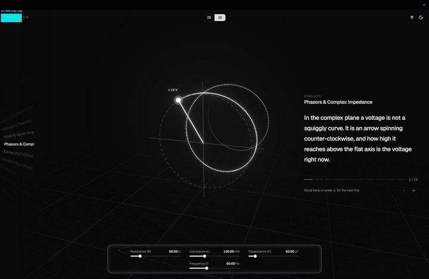

# Phasorium

**Interactive 3D visualizations that make electrical engineering intuitive.**

Each concept is a Three.js scene plus a few sliders: move a parameter and watch the physics
respond in real time. Many concepts also carry a narration — one sentence per step, revealed
word by word, with the scene assembling itself as you scroll.

Scope is electrical engineering broadly: electromagnetics, circuits, electronics, power systems,
machines, control, and installations. Exam material (e.g. the Korean 전기기사 license) is welcome,
but every concept stands on its own for any learner.
